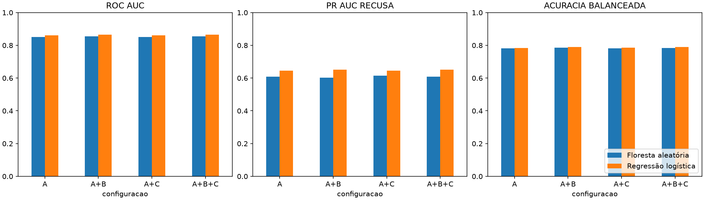
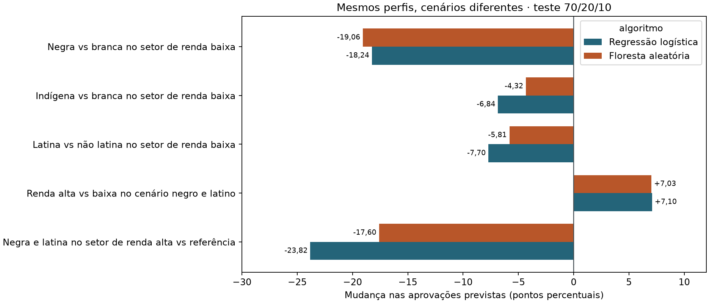
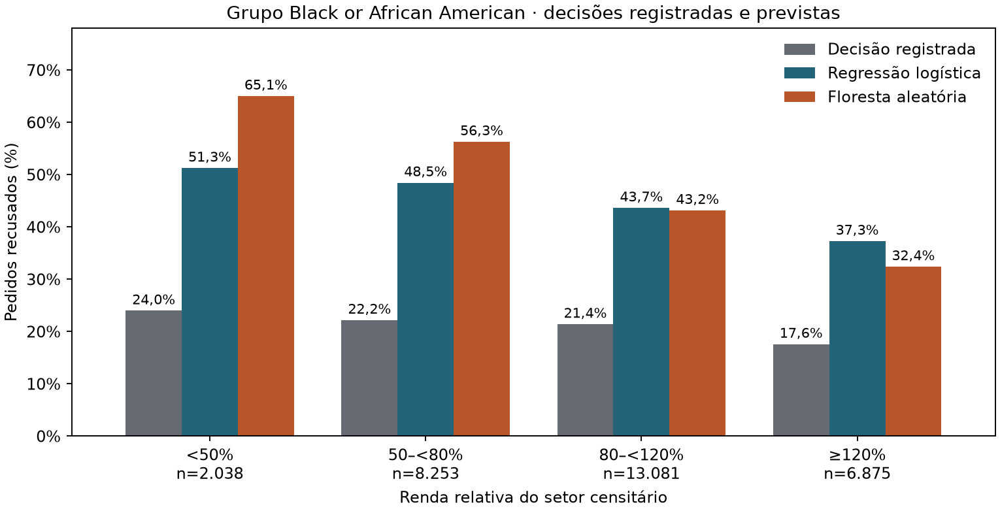

## Passo 1 — Motivação e definição do tema

Buscávamos desenvolver um projeto que proporcionasse aprendizado, fosse fácil de apresentar e trouxesse uma abordagem minimamente inovadora.

Decidimos investigar o processo de concessão de crédito, com foco em possíveis desigualdades relacionadas à raça, à etnia e às condições socioeconômicas dos solicitantes. Entretanto, o dataset do Lending Club não disponibilizava todas as informações necessárias para essa análise, o que nos motivou a buscar outras alternativas.

## Passo 2 — Escolha do dataset e definição do problema

Encontramos o HMDA (Home Mortgage Disclosure Act), uma base de dados que reúne informações sobre solicitações de crédito para financiamento imobiliário.

Pegamos a versão nacional de 2024 dos Estados Unidos, congelada em 19 de maio de 2025. Cada linha representa um pedido ou uma operação registrada. Por isso, quando falamos em quantidade de linhas, estamos contando pedidos ou operações, e uma mesma pessoa pode aparecer mais de uma vez. [Proveniência dos dados](data-provenance.md)

Além do perfil financeiro dos solicitantes, o dataset disponibiliza informações sobre raça, etnia e características socioeconômicas da região onde o imóvel está localizado, incluindo a renda relativa da região.

A partir das informações disponíveis, definimos as seguintes perguntas de pesquisa:

- Quais fatores estão mais associados à aprovação de crédito imobiliário?
- Pessoas com perfis financeiros semelhantes, mas de diferentes raças ou etnias, apresentam taxas de aprovação diferentes? Qual é a diferença percentual?
- Pessoas com perfis financeiros semelhantes apresentam diferentes taxas de aprovação ao solicitar financiamento de imóveis em regiões de alta e baixa renda?
- Como a combinação entre raça, etnia e características socioeconômicas da região está relacionada às taxas de aprovação de crédito imobiliário?

Em resumo, gostaríamos de responder à seguinte pergunta:

Dois indivíduos, um branco e outro negro ou latino, com perfis financeiros equivalentes, possuem a mesma probabilidade de aprovação de crédito ao solicitar o financiamento de um imóvel em um bairro de alto padrão?

Nosso objetivo é identificar possíveis desigualdades na concessão de crédito imobiliário, considerando solicitantes com condições financeiras semelhantes.

## Passo 3 — Escolha das variáveis e definição do alvo

O dataset que pegamos é o de 2024 e nele existem 99 campos para trabalharmos. Nosso desafio dessa segunda fase foi escolher quais campos vamos separar e quais nos interessam. Precisamos dos campos que definem o perfil financeiro do solicitante e o pedido, dos campos que mostram raça e etnia e do campo que descreve a renda relativa da região do imóvel de interesse do solicitante. Chamamos esses conjuntos de A, B e C.

Para A, olhando só para o solicitante, pegamos `income`, que é a renda anual informada, `applicant_age`, que é a faixa de idade, e `debt_to_income_ratio`, que mostra quanto da renda mensal está comprometida com dívidas.

Ainda para A, olhando para o financiamento, pegamos `loan_amount` para o valor solicitado, `loan_term` para o prazo, `loan_type` para a modalidade de crédito e `lien_status` para a prioridade da garantia sobre o imóvel. Do imóvel pegamos `property_value` para o valor do imóvel, `construction_method` para o método de construção e `total_units` para saber quantas moradias o imóvel tem (uma casa de três quartos conta como uma unidade). Para fechar os 12 campos de A, usamos `lei`, o código do banco, cooperativa de crédito ou outra instituição que informou o pedido ao HMDA, e `activity_year` para o ano do registro.

Para B, pegamos `derived_race` para raça e `derived_ethnicity` para etnia. São dois campos separados, então um pedido pode aparecer como negro no campo de raça e como hispânico ou latino no de etnia. Por exemplo, um pedido pode ter `Black or African American` em raça e `Hispanic or Latino` em etnia. Outro pode ter `White` em raça e `Not Hispanic or Latino` em etnia. Se a raça não estiver disponível, o HMDA pode registrar `Race Not Available` e ainda informar a etnia. Essas categorias do HMDA também podem incluir informações do co-solicitante.

Para C, pegamos `tract_to_msa_income_percentage`, que compara a renda familiar mediana da área onde fica o imóvel com a da região de referência. Pra entender, imagine dois pedidos de financiamento. Nos dois, você ganha 100 mil dólares por ano e pede o mesmo valor ao banco. No primeiro pedido, a casa fica numa área onde a renda típica das famílias é de 50 mil dólares por ano. No segundo, a casa fica numa área onde essa renda é de 150 mil.

Se a renda típica da região de referência for de 100 mil dólares, o C da primeira casa vale 50% e o da segunda vale 150%. Nos dois pedidos, sua renda pessoal continua sendo de 100 mil em A. Só mudamos o número que descreve a área da casa.

Aí fazemos a pergunta que queremos testar: com o mesmo salário e o mesmo pedido, o modelo mudaria a previsão de aprovação se trocássemos só a informação sobre a área do imóvel? No exemplo usamos 50% e 150% para facilitar a conta. No nosso estudo, usamos 67% e 143% para fazer essa comparação.

Com esses campos separados, começamos com A e depois testamos A+B, A+C e A+B+C. Em cada rodada, usamos os mesmos pedidos de teste para ver o que muda quando acrescentamos essas informações. Pegamos apenas pedidos de compra de residência principal.

Pra saber como cada pedido terminou, pegamos o campo `action_taken`. Ele guarda o desfecho que a instituição informou ao HMDA. Imagine três pessoas pedindo financiamento ao banco. A primeira conseguiu o crédito e fechou o contrato. O pedido dela recebe código 1. A segunda também conseguiu aprovação, mas não aceitou a proposta. O pedido dela recebe código 2. A terceira teve o pedido negado pelo banco. O pedido dela recebe código 3.

Como nossa pergunta é se o banco aprovou o pedido, juntamos os códigos 1 e 2 como **aprovado** e usamos o código 3 como **recusado**. Pedidos retirados antes de uma decisão ou encerrados por falta de documentação ficam fora do recorte. No treino, essa classificação é a resposta que o modelo tenta aprender. No teste, mostramos ao modelo só os campos de entrada e depois comparamos a previsão com a decisão registrada.

Dos 99 campos do CSV, lemos 18 no preparo. Até 15 entram no modelo, dois servem para filtrar a finalidade e o tipo de ocupação, e um mostra o resultado do pedido. O ano já faz parte de A e também serve de filtro. Primeiro pegamos os pedidos de 2024 que são de compra de residência principal e têm aprovação ou recusa registrada. Depois, conferimos se os 18 campos de cada pedido são válidos.

Quando conferimos os 18 campos, vimos que o CSV tinha 12.229.298 linhas. Dessas, 5.998.031 tinham todos os 18 campos válidos e 6.231.267 tinham pelo menos um valor inválido ou indisponível. Aplicando os filtros do estudo, ficamos com 3.794.116 pedidos. Nesse recorte, **2.910.642 linhas tinham os 18 campos válidos (76,71%)** e **883.474 tinham pelo menos um campo inválido ou indisponível (23,29%)**. Os campos com mais problemas foram raça (`derived_race`, 544.974), etnia (`derived_ethnicity`, 486.044), valor do imóvel (`property_value`, 140.683), relação dívida/renda (`debt_to_income_ratio`, 118.947), renda relativa da área (`tract_to_msa_income_percentage`, 99.941), prazo (`loan_term`, 88.533), renda do solicitante (`income`, 28.908) e idade (`applicant_age`, 2.118). Um pedido pode ter problema em mais de um campo. Para o treinamento descrito a seguir, seguimos com os 2.910.642 pedidos que passaram na validação dos 18 campos.

## Passo 4 — Como preparamos os dados no notebook 01

Como o CSV é grande, abrimos no notebook 01 um bloco de 100 mil linhas por vez e lemos só as 18 colunas que escolhemos. No fim, passamos pelo arquivo inteiro. Em cada bloco, primeiro filtramos o ano, a finalidade da compra, o tipo de ocupação e o resultado do pedido. Depois, usamos o mesmo script da auditoria para conferir campo por campo. Por exemplo, se a idade veio com o código `8888`, que indica idade indisponível, aquele pedido ficou fora da base de treinamento.

Para os pedidos que passaram, convertemos campos como renda e valor do imóvel em números. Campos como faixa de idade e modalidade de crédito ficaram como categorias. Também criamos a coluna `approved`, com 1 para pedidos aprovados e 0 para recusados. Guardamos os 15 campos de entrada e essa resposta num arquivo Parquet, que é o arquivo que o notebook de treinamento abre. O notebook 01 também salva as contagens de cada etapa e mostra quantos valores inválidos ou indisponíveis encontramos em cada coluna.

No arquivo final ficaram 2.570.870 pedidos aprovados e 339.772 recusados. Esse é o ponto de partida do treinamento. O Parquet e os relatórios de preparo ficam em `data/processed/valid_18`. [Notebook 01](../notebooks/01_validacao_e_preparo.ipynb)

## Passo 5 — Como separamos os pedidos e treinamos os modelos

O que a gente quer ensinar ao modelo é bem direto. Dado um pedido de financiamento, ele tem que prever se o banco aprovaria ou recusaria aquele pedido, com base nas decisões que já aconteceram. Imagine uma ficha com a renda da pessoa, o valor pedido e as informações do imóvel na frente. No verso está a resposta que veio do HMDA, aprovado ou recusado. Usamos essas fichas de três jeitos diferentes.

### Pra que servem as três pilhas de pedidos?

Na primeira pilha, a de **treinamento**, estão 2.037.448 pedidos, cerca de 70% da base validada. O modelo pode ver a frente e o verso das fichas. Ele usa as informações do pedido e a decisão registrada pra aprender quais padrões aparecem mais nas aprovações e nas recusas.

Na pilha de **validação**, temos 582.129 pedidos. A gente sabe quais solicitações o banco aprovou e quais ele recusou. Usamos essas respostas pra escolher uma regra, como quando a escola escolhe a nota mínima pra passar.

Imagina dois pedidos. O modelo deu **80 pontos de 100** para o pedido da Ana e **60 pontos de 100** para o do Bruno. O banco aprovou a Ana e recusou o Bruno. Se a nota mínima for **50**, os dois passam e a gente erra o pedido do Bruno. Se a nota mínima for **70**, só a Ana passa e a gente acerta os dois.

Essa nota mínima é o **ponto de corte**. Os 70 pontos são só do exemplo. No trabalho, a gente experimenta vários cortes e confere se consegue acertar bem tanto os pedidos aprovados quanto os recusados. Depois de escolher um corte, usamos essa regra na pilha de teste.

Na terceira pilha, a de **teste**, estão os outros 291.065 pedidos, cerca de 10%. A gente entrega só a frente da ficha ao modelo. Ele faz a previsão com o corte já escolhido. Depois viramos a ficha pra ver se a previsão bate com o que o banco registrou. É como fazer uma prova com questões que ficaram guardadas até o fim.

Imagina que a gente tenha só 100 pedidos, com 90 aprovados e 10 recusados. Na pilha de treino, que tem 70 pedidos, colocamos 63 aprovados e 7 recusados. Na de validação, que tem 20 pedidos, colocamos 18 aprovados e 2 recusados. Na de teste, que tem 10 pedidos, colocamos 9 aprovados e 1 recusado. As pilhas têm tamanhos diferentes, mas em todas, 9 de cada 10 pedidos são aprovados. Fazer a divisão mantendo essa proporção é o que chamamos de **divisão estratificada**.

A **semente 42** é só o número que usamos pra começar o sorteio. Se rodarmos o notebook de novo com os mesmos dados e a mesma semente, os mesmos pedidos vão pras mesmas pilhas. [Notebook 02](../notebooks/02_treinamento_recorte_integral.ipynb)

### Como cada modelo aprende?

A **regressão logística** lê as informações do pedido e devolve um número de 0% a 100%. Esse número é a chance de aprovação que o modelo estima. Imagine que ele dê 80% para a Ana. Se o ponto de corte escolhido na validação for 70%, a previsão para o pedido dela é “aprovado”. Os valores aqui são só um exemplo.

Mas de onde vem esse 80%? Na pilha de treino, o modelo vê muitos pedidos junto com as respostas dos bancos. Ele vai ajustando o peso que dá a cada informação, como a renda do solicitante ou o prazo do empréstimo, para que suas previsões se aproximem das respostas registradas. Quando chega uma ficha nova, ele usa os pesos que aprendeu e combina as informações daquela ficha pra calcular a chance de aprovação.

Antes disso, a gente precisa preparar a ficha pra virar números que o modelo consiga ler. Por exemplo, se o campo diz “financiamento convencional”, criamos uma pergunta simples. “Esse financiamento é convencional?” Se sim, colocamos 1. Se não, colocamos 0. Também ajustamos a escala dos números. O valor de um imóvel pode estar na casa dos milhares, enquanto o prazo está em meses. Colocar esses campos em escalas comparáveis ajuda a regressão a trabalhar com os dois. Essas transformações são aprendidas na pilha de treino e depois usadas do mesmo jeito na validação e no teste.

Na **floresta aleatória**, pensa em um caminho com várias perguntas de Sim ou Não. Na árvore que exportamos com a divisão anterior, a primeira pergunta é “a pessoa tem entre 45 e 54 anos?”. Se ela tiver 48 anos, seguimos pelo Sim. A pergunta seguinte naquele caminho é sobre o valor do imóvel. Se ela tiver 35 anos, seguimos pelo Não e vamos por outro caminho. No fim chegamos a uma **folha**, que é onde a árvore dá sua previsão.

Quem escolhe as perguntas é a própria árvore durante o treino. Ela procura perguntas que ajudem a separar os pedidos já aprovados dos já recusados. Uma floresta junta **100 árvores**, e cada uma aprende com um sorteio próprio de pedidos da pilha de treino. Pro mesmo pedido, uma árvore pode dar 80% de chance de aprovação e outra, 60%. A floresta tira a média das chances dadas pelas 100 árvores. Depois usamos o ponto de corte pra transformar essa média em “aprovado” ou “recusado”. Dá pra seguir um caminho de verdade clicando em Sim ou Não no [PDF navegável](arvore-de-decisao-hmda.pdf) ou ver o [exemplo do Titanic na aula](https://ecad.ifspcaraguatatuba.edu.br/mod/resource/view.php?id=267991).

### Por que são oito combinações?

Imagina quatro versões da ficha da Ana. Na primeira, a gente mostra só **A**, com o perfil financeiro e os dados do pedido e do imóvel. Na segunda, mostra **A+B**, ou seja, a mesma ficha com raça e etnia. Na terceira, mostra **A+C**, a ficha original com a renda relativa da área do imóvel. Na quarta, mostra **A+B+C**, com os dois acréscimos.

Treinamos quatro versões da regressão logística e quatro da floresta aleatória, uma para cada tipo de ficha. Então são **dois algoritmos vezes quatro conjuntos de informações, dando oito combinações**. Usamos os mesmos pedidos nas três pilhas. Assim, quando comparamos A com A+B na regressão, por exemplo, vemos o que muda quando o modelo passa a ter acesso a raça e etnia. Cada combinação tem um ponto de corte escolhido na validação. No teste, o corte daquela combinação é o mesmo pra todo mundo.

### Como testamos o mesmo perfil em situações diferentes?

Aqui a gente faz um exercício com um modelo que já foi ajustado. Pegamos uma ficha de teste e fazemos duas cópias. Nas duas, a pessoa tem a mesma renda, pede o mesmo valor, informa o mesmo valor de imóvel e tem os mesmos dados de raça e etnia. Em uma cópia, colocamos **67%** no campo da renda relativa da área do imóvel. Na outra, colocamos **143%**. Mandamos as duas fichas pro mesmo modelo e vemos se a chance prevista sobe, cai ou fica parecida.

Dá pra fazer o mesmo com raça e etnia. Pra olhar a mudança de raça, por exemplo, mantemos a etnia e a renda da área iguais nas duas cópias e mudamos só o campo de raça. No notebook, criamos **12 versões de cada perfil** porque cruzamos três categorias de raça, duas de etnia e dois valores de renda da área. A comparação ajuda a entender como o modelo reage ao que muda na ficha. Pra dizer como um banco decidiria de verdade, precisaríamos também das outras informações que ele usa e que podem estar fora do HMDA público. [Perguntas e protocolo](perguntas-e-protocolo-hmda.md)

## Passo 6 — O que os gráficos respondem

Os gráficos abaixo usam os relatórios da divisão 70/20/10. O teste reuniu 291.065 pedidos com os 18 campos válidos. [Contexto do projeto](contexto-projeto.md) · [Resultados](resultados-treinamento.md)

### Acrescentar raça e etnia ajuda na previsão?

Pra responder, procuramos as barras de **A** e **A+B** da mesma cor. Cada cor é um algoritmo. No gráfico da esquerda, a **ROC-AUC** indica se o modelo costuma colocar pedidos aprovados acima dos recusados quando os ordenamos pela chance de aprovação. No gráfico do meio, a **PR-AUC para recusas** mostra como o modelo se sai ao procurar pedidos recusados, considerando tanto quantos ele encontra quanto quantos dos que aponta são recusas de verdade. No gráfico da direita, a **acurácia balanceada** é a média de dois acertos. Um é a proporção de aprovados que o modelo acerta. O outro é a proporção de recusados que ele acerta. Nas três métricas, quanto maior a barra, melhor.

Com raça e etnia, a ROC-AUC foi de 0,8611 para 0,8652 na regressão e de 0,8505 para 0,8555 na floresta. A diferença de recusas previstas entre pedidos de pessoas negras e brancas também aumentou. Na regressão, passou de 10,43 para 25,71 pontos. Na floresta, de 7,91 para 30,78 pontos.

### A renda da área acrescenta informação?

No mesmo gráfico, comparamos **A com A+C**. A ROC-AUC mudou pouco. Foi de 0,8611 para 0,8618 na regressão e de 0,8505 para 0,8515 na floresta. Na floresta, a PR-AUC de recusas subiu de 0,6091 para 0,6144.

### A mesma ficha recebe uma previsão diferente se mudarmos raça ou etnia?

Cada barra mostra quanto mudou a **porcentagem de fichas que o modelo classificou como aprovadas**, em pontos percentuais. A barra à esquerda do zero indica menos aprovações previstas. A barra à direita indica mais. Por exemplo, cair de 80% para 66% significa cair 14 pontos percentuais.

Quando trocamos a categoria branca pela negra e mantivemos a etnia não latina e a área de renda baixa, as aprovações previstas caíram 18,24 pontos na regressão e 19,06 na floresta. Trocar de não latina para latina no cenário branco de renda baixa também reduziu as aprovações, em 7,70 e 5,81 pontos.

### A recusa de pedidos de pessoas negras aumenta em áreas de renda mais alta?

Embaixo estão as faixas de renda da área do imóvel. Cada faixa tem três barras. A primeira mostra a porcentagem de recusas registradas pelo banco. As outras mostram a porcentagem de recusas previstas por cada modelo com A+B+C. O número escrito como n mostra quantos pedidos havia naquela faixa.

A recusa registrada passou de 24,00% na faixa abaixo de 50% para 17,60% na faixa de 120% ou mais. Nessa mesma comparação, a recusa prevista caiu de 51,28% para 37,31% na regressão e de 65,06% para 32,42% na floresta.

### O que aparece quando juntamos raça, etnia e renda da área?

Voltamos ao gráfico de **perfis fixos**. No cenário negro e latino, trocar a área de renda baixa pela de renda alta aumentou as aprovações previstas em cerca de sete pontos nos dois algoritmos. Mesmo em área de renda alta, a aprovação prevista nesse cenário ficou 23,81 pontos abaixo da referência branca, não latina e de renda baixa na regressão, e 17,60 pontos abaixo na floresta.

### Os resultados se repetem entre modelos, instituições e anos?

Na configuração **A+B+C**, a regressão teve ROC-AUC de 0,8655 e a floresta, 0,8554. As duas apontaram quedas nas aprovações previstas em vários cenários, de tamanhos diferentes. A comparação por instituição ainda precisa ser feita separadamente. Pra falar de outros anos, precisamos de dados de outros períodos.

Pra fechar o pitch, podemos dizer que acrescentar os campos mudou pouco algumas métricas gerais, mas mudou mais as previsões de alguns perfis. Esses números descrevem as decisões registradas e a reação dos modelos às fichas simuladas. [Tabela com as seis respostas no artigo](../artigo.tex)
